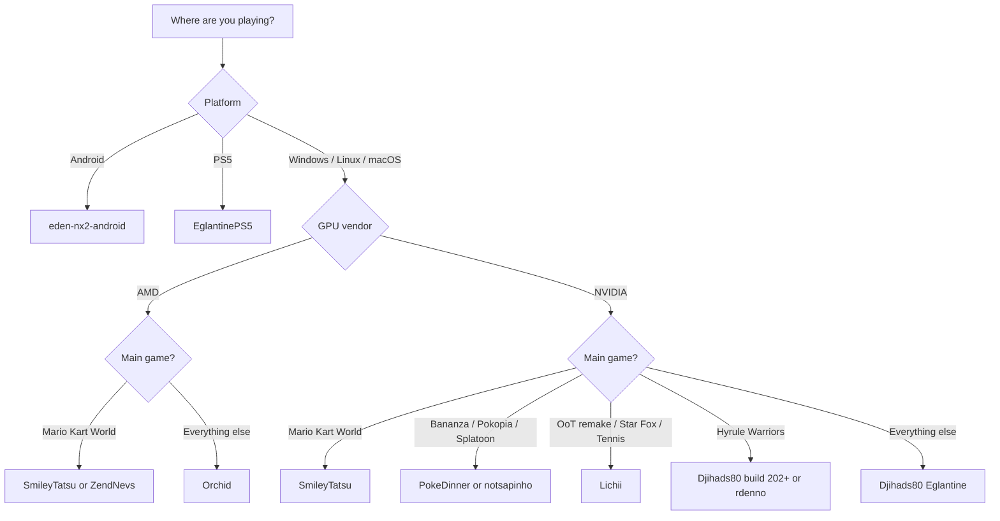

# Which Forks?

**A use-case guide to Nintendo Switch 2 emulator forks — which build to pick for your GPU, OS, and the game you actually want to play.**

[](#update-log)
[](LICENSE)
[](CONTRIBUTING.md)

> [!WARNING]
> Everything here is **very experimental**. Builds land several times a day, regress without notice, and fork rankings are per-game and per-driver — not absolute. "Best" below means "best documented starting point for that use case on 5 Nov 2026", nothing more.

---

## The 30-second answer

| Your situation | Start here | Why |
|---|---|---|
| Windows/Linux, NVIDIA, first install | **[Djihads80/Eglantine](https://github.com/Djihads80/Eglantine/releases)** | The central upstream: most tested, most builds, all-round compatibility |
| AMD GPU (RDNA2+) | **[MythosOfs/Orchid](https://github.com/MythosOfs/Orchid/releases)** | Independent fork with AMD-focused shader/GPU fixes; developed on an RX 9070 XT |
| Mario Kart World above all | **[SmileyTatsu/Eglantine](https://github.com/SmileyTatsu/Eglantine/releases)** | Dedicated MKW frame-rate, pipeline-cache and RAM fixes; AMD + NVIDIA |
| Donkey Kong Bananza | **[PokeDinner](https://git.eden-emu.dev/Franseven/PokeDinner-a-Eglantine-Fork/releases)** | Release notes explicitly target DK terrain and rendering |
| Pokémon Pokopia | **[notsapinho/Eglantine](https://github.com/notsapinho/Eglantine/releases)** or **PokeDinner** | Both list Pokopia as a target; notsapinho calls it playable |
| Splatoon Raiders | **[PokeDinner](https://git.eden-emu.dev/Franseven/PokeDinner-a-Eglantine-Fork/releases)** | Textbox, texture and HDR fixes |
| Zelda OoT remake / Star Fox / Mario Tennis | **[zortos293/Lichii](https://github.com/zortos293/Lichii/releases)** | Community-reported game-focused builds |
| Hyrule Warriors: Age of Imprisonment | **[Djihads80 build 202+](https://github.com/Djihads80/Eglantine/releases)** or **rdenno** | Build 202 was the Hyrule Warriors fix set (46–49 FPS median reported) |
| Android phone/tablet | **[moceure/eden-nx2-android](https://git.eden-emu.dev/moceure/eden-nx2-android/tags)** | The maintained NX2 Android build found at check time |
| PS5 | **[heydemoura/EglantinePS5](https://github.com/heydemoura/EglantinePS5)** | Experimental PS5 port of Eglantine |
| Zen 3 CPU, chasing FPS | **[selevet-eglantine](https://github.com/sylvieistaken/selevet-eglantine/releases)** | PGO + ThinLTO build tuned for Zen 3 |
| MKW + frame generation / 30 FPS lock | **[ZendNevs/Eglantine-ZendNevs](https://github.com/ZendNevs/Eglantine-ZendNevs/releases)** | FSR 3 / LSFG, DynamicFPS, 30 FPS lock |

**If you only read one line:** install Djihads80/Eglantine first. Switch forks only when a specific game or your GPU is broken — and keep the build that worked.

---

## Decision tree



---

## Confidence legend

Claims in this repo are labelled, because the scene is full of "60 FPS trust me bro":

| Label | Meaning |
|---|---|
| **Documented** | The fork's README or release notes state it. |
| **Corroborated** | Two or more independent [experience reports](docs/REPORTS.md) on the same game + fork + GPU class agree. |
| **Community-reported** | Comes from the 5 Nov 2026 community update or third-party posts; not independently reproduced here. |
| **Source-only** | No prebuilt binary at check time; build it yourself. |

---

## The forks

### Djihads80/Eglantine — the central fork

**All games · Windows / Linux / macOS · NVIDIA + AMD · Documented**

The reference Eglantine build, derived from Eden, Yuzu and Sudachi and started by Camille LaVey. At check time: **4.1k stars**, GPL-3.0, latest pre-release **build-212** (4 Nov 2026), a **daily-20261105** build, and a tagged **v0.1.0-rc1**. The "last stable build 196" figure in circulation is already behind — builds 200+ include the Hyrule Warriors fix set.

- **Pick it if:** you want the default, the widest game coverage, and the build most forks rebase on.
- **Watch out:** "stable" is relative. These are pre-releases; pin a build that works for your game and don't update mid-playthrough.

### SmileyTatsu/Eglantine — Mario Kart World specialist

**MKW · Windows / Linux / macOS · AMD + NVIDIA · Documented**

A fork of Djihads80 with pipeline-cache changes, guest-RAM release work and a Mario Kart World frame-rate fix that are not all merged upstream. Latest at check: **build-16** (5 Nov 2026), 10 release assets. The fork's README still points to upstream for downloads, but its own Releases tab is populated.

- **Pick it if:** MKW is your main game, on either GPU vendor.
- **Watch out:** small fork (6 stars), fast-moving; changes may be rebased or dropped.

### MythosOfs/Orchid — AMD / independent

**AMD GPUs · Windows / Linux / macOS (Apple Silicon) · Documented**

Started as an Eglantine fork, now independent. Adds Ampere shader-instruction lowerings, Switch 2 font handling, kernel thread-race fixes, and graphics fixes (texture copies, descriptor buffers, geometry shaders). Latest: **v0.7.2** (5 Nov 2026), GPL-3.0, Windows zip + Linux AppImage (PGO variants) + experimental macOS 15+ arm64 build.

- **Pick it if:** you're on AMD — the performance table was measured on a 5800X3D + RX 9070 XT with Mesa RADV from git.
- **Reported results:** 60 FPS in Mario Tennis Fever and Super Mario Bros. Wonder; 30–40 FPS in MKW with asset glitches.
- **Watch out:** release builds can lag commits; self-build for the newest code.

### PokeDinner (Franseven) — the game-specific lab

**Bananza · Pokopia · Splatoon · OoT · MKW · Windows/Linux/macOS · Documented**

Hosted on the Eden Forgejo. Release notes read like a per-game changelog: initial OoT support, Splatoon Raiders textboxes/textures/HDR, MKW "now goes ingame", Donkey Kong terrain fixes, Pokopia invisible items/sky/reflections, and initial (not ready) Fire Emblem Fortune's Weave support. Latest tag **2.7.7** is **Windows-only and explicitly broken/experimental**; 1.x/2.0.0 tags include Linux AppImage and macOS arm64.

- **Pick it if:** you're chasing one of the titles above.
- **Watch out:** the author warns about AMD GPUs and asks for a 32 GB pagefile/swap plus 12 GB DRAM. Only one dynamic/30 FPS lock at a time.

### notsapinho/Eglantine — Pokopia build

**Pokopia · Windows x64 / Linux x86_64+arm64 · Documented**

Independent Eglantine-based build. Every push to `main` is published. Latest: **build-11** (4 Nov 2026). README lists **Pokopia as playable**, plus MKW and Splatoon Raiders. x86_64 builds require **AVX2** (Haswell+ / Ryzen).

- **Pick it if:** Pokopia is the goal and you want a simpler build than PokeDinner.
- **Watch out:** very small project (5 stars); expect crashes and glitches.

### zortos293/Lichii — game-patch fork

**OoT remake · Bananza · Star Fox · Mario Tennis · Windows · Community-reported**

A large Eglantine-derived fork (**~1.5k stars**) that also handles Switch 1 titles. Latest: **build-75** (5 Nov 2026). The repo README does not publish a title list, so the game associations above come from the community update, not from upstream docs.

- **Pick it if:** you want the specific titles attributed to it.
- **Watch out:** verify the game in the release notes of the build you download; the project still uses the historical "Eglantine" name internally.

### rdenno/Eglantine — nx2-merged / Hyrule Warriors

**Hyrule Warriors · Windows / Linux / macOS · Community-reported**

Fork of Djihads80 with an `nx2-merged` branch and its own builds (**build-8**, 4 Nov 2026, 10 assets). Hyrule Warriors: Age of Imprisonment improvements landed upstream around build 202, so this fork is an alternative route to that fix set rather than a separate magic build.

- **Pick it if:** you want a second build to A/B against upstream for Hyrule Warriors.
- **Watch out:** tiny fork (4 stars); no game list in the README.

### ZendNevs/Eglantine — Mario Kart World + frame generation

**MKW · Windows · NVIDIA + AMD · Documented**

An Eglantine fork focused on perceived smoothness: **FSR 3 and LSFG frame generation**, **DynamicFPS**, and a **30 FPS lock**. Latest at check: **v2.0.5** (3 Nov 2026), 94 stars, Windows only. The author states it is only tested on Mario Kart World.

- **Pick it if:** MKW is your main game and you want frame generation or a locked 30 FPS profile on weaker hardware.
- **Watch out:** frame generation interpolates frames — it improves perceived smoothness, not the simulation rate, and adds latency. Don't use a frame-gen build to judge raw compatibility. **No license is declared** on the repo at check time, which matters if you redistribute or bundle it.

### moceure/eden-nx2-android — Android

**Android / ARM64 · Documented**

The maintained Android NX2 build found at check time, on the Eden Forgejo. Latest: **v0.3.2** (2 Nov 2026); seven releases in the v0.3.x line. Hosted on Forgejo rather than GitHub.

- **Pick it if:** you're on an Android phone/tablet.
- **Watch out:** desktop parity is not there. Snapdragon/Adreno + current Turnip drivers are the path of least resistance; Mali is hit-or-miss. Expect thermal throttling to dominate long sessions.

### Other forks worth knowing

Lower confidence, but relevant depending on hardware:

| Fork | Platform | Why it exists | Confidence |
|---|---|---|---|
| [selevet-eglantine](https://github.com/sylvieistaken/selevet-eglantine/releases) | Windows/Linux | Zen 3-tuned, PGO + ThinLTO, faster GPU mapping · 121★ · build 6 (3 Nov) | Documented |
| [heydemoura/EglantinePS5](https://github.com/heydemoura/EglantinePS5) | PS5 | Experimental PS5 port · 195★ · GPL-3.0 | Community-reported |
| [astralbeexd/Eglantine-3060Ti-16GB](https://github.com/astralbeexd/Eglantine-3060Ti-16GB) | Windows | Niche build named for one GPU · 11★ | Unverified |

> A missing license matters if you plan to redistribute or bundle a build: ZendNevs declares none, while GPL-3.0 forks must publish source. Check before trusting a binary-only repack.

---

## Game → fork matrix

| Game | First pick | Also try | Evidence |
|---|---|---|---|
| Mario Kart World | SmileyTatsu | Djihads80; Orchid (AMD); ZendNevs (frame gen) | Documented MKW fixes; Orchid reports 30–40 FPS with asset glitches |
| Donkey Kong Bananza | PokeDinner | Lichii | PokeDinner release notes (terrain, black-hole rendering); Lichii community-reported |
| Pokémon Pokopia | notsapinho | PokeDinner | notsapinho README says playable; PokeDinner notes invisible items/sky/reflections |
| Splatoon Raiders | PokeDinner | Djihads80; notsapinho | PokeDinner textbox/texture/HDR fixes; upstream says variable performance |
| Zelda: OoT remake | Lichii | PokeDinner | Community-reported; PokeDinner lists initial OOT support |
| Star Fox | Lichii | Djihads80 | Community-reported |
| Mario Tennis Fever | Lichii | Orchid | Community-reported; Orchid measured 60 FPS |
| Hyrule Warriors: AoI | Djihads80 build 202+ | rdenno nx2-merged | Build 202 fix set; 46–49 FPS median reported |
| Super Mario Bros. Wonder | Orchid | Djihads80 | Orchid reports 60 FPS (Switch 1 title) |
| Fire Emblem Fortune's Weave | PokeDinner | — | Initial support, explicitly "not ready" |

> Game names are used only to describe compatibility targets. No game files, keys, or firmware are hosted or linked here.

---

## Community reports — help improve the ranking

The matrix above is a snapshot of documentation and community claims. Reports from people who actually ran a build are what turn it into a ranking that can be trusted.

**Two ways to contribute**

1. **Issue form (2 minutes)** — [open an experience report](../../issues/new?template=experience-report.yml). Dropdowns and fields cover fork, build, game, platform, CPU/GPU/driver, RAM, settings, FPS, and outcome.
2. **Pull request (structured)** — add a JSON file to [`data/reports/`](data/reports/README.md). CI validates it, and `scripts/reports.py render` refreshes [`docs/REPORTS.md`](docs/REPORTS.md).

**How reports change the ranking**

- One report is an anecdote: it is published but does not move a recommendation.
- Two or more independent reports on the same game + fork + GPU class make a claim **corroborated**; the first-pick column can then change.
- Reports with a real build tag, a log, or a screenshot weigh more.
- Negative reports (won't boot, crashes) demote a fork for that game — they are as useful as positive ones.
- Configs are compared by GPU class (vendor + generation), not exact card, so one RX 9070 XT report still helps other RDNA4 users.

Reports are public. Don't post keys, firmware, ROMs, or personal information.

## Setup checklist

1. **Bring your own dump.** You need your own game dump, `prod.keys`, and firmware. None of these are included in any fork.
2. **Drivers first.** Current Vulkan driver: Adrenalin on Windows AMD, Mesa RADV (git) on Linux AMD, current NVIDIA driver on NVIDIA.
3. **RAM/pagefile.** 16 GB RAM is a practical floor; PokeDinner asks for 12 GB DRAM + a 32 GB pagefile/swap. Close the browser.
4. **Warm the shader cache.** First minutes stutter while pipelines compile. Never benchmark cold, and don't judge a build on the first launch.
5. **One variable at a time.** Change build *or* driver *or* settings — not all three — then retest the same save and route.
6. **Keep a known-good build.** Zip the working folder before updating. Builds land hourly; regressions are normal.
7. **Prefer repo releases over repacks.** Random "optimized" bundles are the main malware vector in this scene. Builds from GPL repos should have source available.

### Android specifics

- Prefer Snapdragon/Adreno; use a current Turnip driver if the app allows a custom driver.
- 8 GB RAM minimum, 12 GB+ realistic for Switch 2 titles.
- Expect throttling: a 10-minute benchmark is more honest than a 30-second one.
- The Android build tracks desktop NX2 work with a lag; don't expect the same game list on day one.

---

## How to judge a fork (and an aggregator)

Forks are full emulator copies, not plugins. Before trusting one:

- **Does it link upstream?** A fork should name its base (Eglantine/Eden/Yuzu/Sudachi) and publish source if it's GPL.
- **Does it publish real release notes?** "Performance boost" with no commit/build detail is noise.
- **Does it bundle keys, firmware, or games?** That's a red flag — don't use it.
- **Is it current?** Compare its last push/release date with upstream. A fork that stopped a week ago is already stale in this scene.
- **Can you reproduce the claim?** Same game, same save, same route, warm cache. Otherwise treat FPS numbers as anecdotes.

### About "Amazing-*" / "Awesome-*" aggregator repos

Repos that "regroup" forks (often prefixed **Amazing-**, **Awesome-**, **Mega-**, etc.) are **indexes, not emulators**. They can be useful for discovery, but they add a layer of latency and trust between you and the actual build.

At the time of writing (5 Nov 2026) we could **not verify any GitHub repository with an "Amazing-" prefix** related to Switch 2/Eglantine forks. If you know one, open an issue with the link. This repo will list an aggregator only if it:

1. links to the upstream repo/release for every entry,
2. states the build provenance and date, and
3. does not bundle or link copyrighted files.

Forks also vanish overnight (DMCA, renames, account deletion). If a link 404s, search the project name plus "fork" and prefer a repo that still publishes source.

---

## Legal & safety

- Emulators are legal in many jurisdictions; **ROMs, keys, and firmware are copyrighted**. Dump your own games and don't share the files.
- This repo contains **no copyrighted content** and links only to public source repositories and release pages.
- These are **unsigned community binaries**. If you don't trust a build, build it from source or don't run it.
- Nothing here is legal advice; rules differ by country.

---

## Sources

All links checked 5 Nov 2026. Release metadata read from the GitHub/Forgejo APIs on the same date.

- Central fork: [Djihads80/Eglantine](https://github.com/Djihads80/Eglantine) · [releases](https://github.com/Djihads80/Eglantine/releases)
- MKW fork: [SmileyTatsu/Eglantine](https://github.com/SmileyTatsu/Eglantine) · [releases](https://github.com/SmileyTatsu/Eglantine/releases)
- AMD/independent: [MythosOfs/Orchid](https://github.com/MythosOfs/Orchid) · [releases](https://github.com/MythosOfs/Orchid/releases)
- Game-specific lab: [PokeDinner](https://git.eden-emu.dev/Franseven/PokeDinner-a-Eglantine-Fork) · [releases](https://git.eden-emu.dev/Franseven/PokeDinner-a-Eglantine-Fork/releases)
- Pokopia build: [notsapinho/Eglantine](https://github.com/notsapinho/Eglantine) · [releases](https://github.com/notsapinho/Eglantine/releases)
- Game patches: [zortos293/Lichii](https://github.com/zortos293/Lichii) · [releases](https://github.com/zortos293/Lichii/releases)
- Hyrule Warriors / nx2-merged: [rdenno/Eglantine](https://github.com/rdenno/Eglantine) · [releases](https://github.com/rdenno/Eglantine/releases)
- Android: [moceure/eden-nx2-android](https://git.eden-emu.dev/moceure/eden-nx2-android) · [tags](https://git.eden-emu.dev/moceure/eden-nx2-android/tags)
- Zen 3 build: [selevet-eglantine](https://github.com/sylvieistaken/selevet-eglantine) · [releases](https://github.com/sylvieistaken/selevet-eglantine/releases)
- Frame-gen build: [ZendNevs/Eglantine-ZendNevs](https://github.com/ZendNevs/Eglantine-ZendNevs) · [releases](https://github.com/ZendNevs/Eglantine-ZendNevs/releases)
- PS5 port: [heydemoura/EglantinePS5](https://github.com/heydemoura/EglantinePS5)

---

## Contributing

Found a fork that deserves a row, or a link that died? Read [CONTRIBUTING.md](CONTRIBUTING.md) and open a PR. Rules: one fork per PR, link the upstream repo, state platform + tested game + build + GPU/driver, and no ROM/key/firmware links.

Data lives in [`data/forks.json`](data/forks.json) and reports live in [`data/reports/`](data/reports/README.md). Run both checks before submitting:

```bash
python -I scripts/check_links.py
python -I scripts/reports.py validate
```

## Update log

| Date | Change |
|---|---|
| 2026-11-05 | Initial guide: 11 forks + 4 niche builds, release endpoints verified, game matrix from documented + community-reported claims. |
| 2026-11-05 | Broke ZendNevs/Eglantine out into its own section (frame generation, DynamicFPS, 30 FPS lock). |
| 2026-11-05 | Added community reports: issue form, JSON schema + validator, generated `docs/REPORTS.md`, CI check. |
