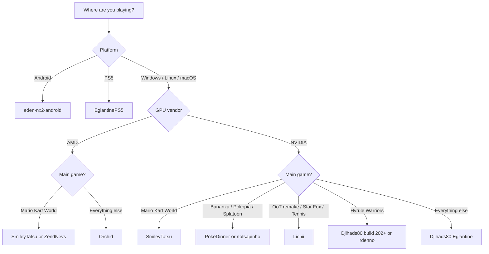

# Which Forks?

A use-case guide to Nintendo Switch 2 emulator forks: which build to pick for your GPU, OS, and the game you want to play.

[](#update-log)
[](LICENSE)
[](CONTRIBUTING.md)

> [!WARNING]
> Everything here is experimental. Builds land several times a day, regress without notice, and fork rankings depend on the game and driver. "Best" below means "best documented starting point for that use case on 5 Nov 2026", nothing more.

---

## The 30-second answer

| Your situation | Start here | Why |
|---|---|---|
| Windows/Linux, NVIDIA, first install | [Djihads80/Eglantine](https://github.com/Djihads80/Eglantine/releases) | The central upstream: most tested, most builds, all-round compatibility |
| AMD GPU (RDNA2+) | [MythosOfs/Orchid](https://github.com/MythosOfs/Orchid/releases) | Independent fork with AMD-focused shader and GPU fixes; developed on an RX 9070 XT |
| Mario Kart World above all | [SmileyTatsu/Eglantine](https://github.com/SmileyTatsu/Eglantine/releases) | Dedicated MKW frame-rate, pipeline-cache and RAM fixes; AMD and NVIDIA |
| Donkey Kong Bananza | [PokeDinner](https://git.eden-emu.dev/Franseven/PokeDinner-a-Eglantine-Fork/releases) | Release notes explicitly target DK terrain and rendering |
| Pokémon Pokopia | [notsapinho/Eglantine](https://github.com/notsapinho/Eglantine/releases) or [PokeDinner](https://git.eden-emu.dev/Franseven/PokeDinner-a-Eglantine-Fork/releases) | Both list Pokopia as a target; notsapinho calls it playable |
| Splatoon Raiders | [PokeDinner](https://git.eden-emu.dev/Franseven/PokeDinner-a-Eglantine-Fork/releases) | Textbox, texture and HDR fixes |
| Zelda OoT remake, Star Fox, Mario Tennis | [zortos293/Lichii](https://github.com/zortos293/Lichii/releases) | Community-reported game-focused builds |
| Hyrule Warriors: Age of Imprisonment | [Djihads80 build 202+](https://github.com/Djihads80/Eglantine/releases) or [rdenno](https://github.com/rdenno/Eglantine/releases) | Build 202 was the Hyrule Warriors fix set (46-49 FPS median reported) |
| Android phone or tablet | [moceure/eden-nx2-android](https://git.eden-emu.dev/moceure/eden-nx2-android/tags) | The maintained NX2 Android build found at check time |
| PS5 | [heydemoura/EglantinePS5](https://github.com/heydemoura/EglantinePS5) | Experimental PS5 port of Eglantine |
| Zen 3 CPU, chasing FPS | [selevet-eglantine](https://github.com/sylvieistaken/selevet-eglantine/releases) | PGO + ThinLTO build tuned for Zen 3 |
| MKW, frame generation, 30 FPS lock | [ZendNevs/Eglantine-ZendNevs](https://github.com/ZendNevs/Eglantine-ZendNevs/releases) | FSR 3 / LSFG, DynamicFPS, 30 FPS lock |

If you only read one line: install Djihads80/Eglantine first. Switch forks only when a specific game or your GPU is broken, and keep the build that worked.

---

## Decision tree



---

## Confidence legend

Claims here are labelled, because the scene is full of "60 FPS trust me bro":

| Label | Meaning |
|---|---|
| Documented | The fork's README or release notes state it. |
| Corroborated | Two or more independent [experience reports](docs/REPORTS.md) on the same game, fork and GPU class agree. |
| Community-reported | Comes from the 5 Nov 2026 community update or third-party posts; not independently reproduced here. |
| Source-only | No prebuilt binary at check time; build it yourself. |

---

## The forks

### Djihads80/Eglantine: the central fork

Runs on Windows, Linux and macOS, with NVIDIA, AMD and Intel GPUs. Claims here are documented.

The reference Eglantine build, derived from Eden, Yuzu and Sudachi and started by Camille LaVey. At check time it had 4.1k stars, GPL-3.0, pre-release build-212 (4 Nov 2026), a daily-20261105 build and a v0.1.0-rc1 tag. The "last stable build 196" figure in circulation is already behind; builds 200+ include the Hyrule Warriors fix set.

Start here if you want the default, the widest game coverage, and the build most forks rebase on. One caveat: "stable" is relative here. These are pre-releases, so pin a build that works for your game and don't update mid-playthrough.

### SmileyTatsu/Eglantine: Mario Kart World specialist

Windows, Linux and macOS builds for AMD and NVIDIA. Documented.

A fork of Djihads80 with pipeline-cache changes, guest-RAM release work and a Mario Kart World frame-rate fix that are not all merged upstream. Latest at check: build-16 (5 Nov 2026), 10 release assets. The fork's README still points to upstream for downloads, but its own Releases tab is populated.

This is the one if Mario Kart World is your main game, on either GPU vendor. The catch: it is a small fork (6 stars) moving fast, so changes may be rebased or dropped.

### MythosOfs/Orchid: AMD and independent

Windows and Linux builds, plus an experimental macOS arm64 build. AMD only. Documented.

Started as an Eglantine fork and now independent. It adds Ampere shader-instruction lowerings, Switch 2 font handling, kernel thread-race fixes, and graphics fixes for texture copies, descriptor buffers and geometry shaders. Latest at check: v0.7.2 (5 Nov 2026), GPL-3.0, with Windows zip, Linux AppImage (PGO variants) and an experimental macOS 15+ arm64 build.

Go for Orchid if you're on AMD. The performance table was measured on a 5800X3D with an RX 9070 XT and Mesa RADV from git, with 60 FPS reported in Mario Tennis Fever and Super Mario Bros. Wonder, and 30-40 FPS in MKW with asset glitches. Keep in mind: release builds can lag commits, so self-build for the newest code.

### PokeDinner (Franseven): the game-specific lab

Windows, Linux and macOS builds. The author warns about AMD GPUs. Documented.

Hosted on the Eden Forgejo. Release notes read like a per-game changelog: initial OoT support, Splatoon Raiders textboxes, textures and HDR, MKW "now goes ingame", Donkey Kong terrain fixes, Pokopia invisible items, sky and reflections, and initial but not ready Fire Emblem Fortune's Weave support. Latest tag 2.7.7 is Windows-only and explicitly broken/experimental; 1.x and 2.0.0 tags include Linux AppImage and macOS arm64.

Reach for PokeDinner if you're chasing one of the titles above. The catch: the author asks for a 32 GB pagefile or swap plus 12 GB DRAM, and only one dynamic or 30 FPS lock can be active at a time.

### notsapinho/Eglantine: Pokopia build

Windows x64 and Linux x86_64/arm64 builds. Documented.

An independent Eglantine-based build. Every push to `main` is published. Latest at check: build-11 (4 Nov 2026). The README lists Pokopia as playable, plus MKW and Splatoon Raiders. x86_64 builds require AVX2 (Haswell or newer, or Ryzen).

Choose it if Pokopia is the goal and you want a simpler build than PokeDinner. Downside: it is a very small project (5 stars), so expect crashes and glitches.

### zortos293/Lichii: game-patch fork

Windows, Linux and macOS builds for NVIDIA and AMD. Community-reported.

A large Eglantine-derived fork (~1.5k stars) that also handles Switch 1 titles. Latest at check: build-80 (5 Nov 2026, commit `7459f10`), published as GitHub Actions artifacts while the Releases page still showed build-75. Artifacts cover Windows x86_64 (PGO and non-PGO), Linux x86_64 and aarch64, and macOS arm64. You need a GitHub account to download them, and they expire.

A community PSA from 5 Nov calls build-80 the most playable OoT remake build so far, with caveats. Field reports from that thread:

- On a 9800X3D, players report about 54-60 FPS, with heavy bloom, sunrays, texture flicker and intermittent black-screen flashes.
- An i3-10100 with an RTX 3060 12 GB and 24 GB RAM gets 20-24 FPS in Kokiri Forest.
- A 3080 10 GB gets 40-50 FPS in Kokiri Forest and 40-60 inside the Deku Tree, with CPU and GPU both under 50%. That points to the emulator, not settings.
- An RTX 2070 with a 9800X3D reportedly holds 60 FPS, while a 7900 XTX with a 13400F does not. CPU single-core speed looks like the limiting factor.
- For black screens, try the non-PGO Windows artifact first; the PGO build caused black screens for several users. Docked mode helped some setups. Some cutscenes stay black with audio only.

A second thread from 5 Nov pushes back on the 60 FPS clips. They are not sustained gameplay: they tend to come from specific areas on high-end hardware, and flicker or bloom can make 60 FPS unplayable anyway. An owner of a 4070 Ti and a 14th-gen i7 still describes the game as emulator-bound, and NVIDIA users report both good and bad results, so the GPU vendor is not a guarantee.

Lichii is the pick if you want OoT remake or the other titles attributed to it, and you have a fast CPU. Before you download: check the release or commit notes of the build, and remember that Actions artifacts are not releases. Keep the zip if a build works. The project still uses the historical "Eglantine" name internally.

### rdenno/Eglantine: nx2-merged and Hyrule Warriors

Windows, Linux and macOS builds for NVIDIA and AMD. Community-reported.

A fork of Djihads80 with an `nx2-merged` branch and its own builds (build-8, 4 Nov 2026, 10 assets). Hyrule Warriors: Age of Imprisonment improvements landed upstream around build 202, so this is another way to get that fix set, not a separate magic build.

Useful if you want a second build to compare against upstream for Hyrule Warriors. The catch: it is a tiny fork (4 stars) with no game list in the README.

### ZendNevs/Eglantine: Mario Kart World and frame generation

Windows only, for NVIDIA and AMD. Documented.

An Eglantine fork focused on perceived smoothness: FSR 3 and LSFG frame generation, DynamicFPS, and a 30 FPS lock. Latest at check: v2.0.5 (3 Nov 2026), 94 stars, Windows only. The author states it is only tested on Mario Kart World.

Worth trying if MKW is your main game and you want frame generation or a locked 30 FPS profile on weaker hardware. One caveat: frame generation interpolates frames. It improves perceived smoothness, not the simulation rate, and adds latency, so don't use a frame-gen build to judge raw compatibility. No license is declared on the repo at check time, which matters if you redistribute or bundle it.

### moceure/eden-nx2-android: Android

Android on ARM64. Documented.

The maintained Android NX2 build found at check time, on the Eden Forgejo. Latest at check: v0.3.2 (2 Nov 2026), with seven releases in the v0.3.x line. It is hosted on Forgejo, not GitHub.

Use it on Android phones and tablets. The catch: desktop parity is not there. Snapdragon or Adreno with current Turnip drivers is the path of least resistance; Mali is hit or miss. Expect thermal throttling to dominate long sessions.

### Other forks worth knowing

Lower confidence, but relevant depending on hardware:

| Fork | Platform | Why it exists | Confidence |
|---|---|---|---|
| [selevet-eglantine](https://github.com/sylvieistaken/selevet-eglantine/releases) | Windows/Linux | Zen 3-tuned, PGO + ThinLTO, faster GPU mapping. 121 stars. Build 6 (3 Nov). | Documented |
| [heydemoura/EglantinePS5](https://github.com/heydemoura/EglantinePS5) | PS5 | Experimental PS5 port. 195 stars. GPL-3.0. | Community-reported |
| [astralbeexd/Eglantine-3060Ti-16GB](https://github.com/astralbeexd/Eglantine-3060Ti-16GB) | Windows | Niche build named for one GPU. 11 stars. | Unverified |

A missing license matters if you plan to redistribute or bundle a build: ZendNevs declares none, while GPL-3.0 forks must publish source. Check before trusting a binary-only repack.

---

## Which fork for which game

| Game | First pick | Also try | Evidence |
|---|---|---|---|
| Mario Kart World | SmileyTatsu | Djihads80; Orchid (AMD); ZendNevs (frame gen) | Documented MKW fixes; Orchid reports 30-40 FPS with asset glitches |
| Donkey Kong Bananza | PokeDinner | Lichii | PokeDinner release notes (terrain, black-hole rendering); Lichii community-reported |
| Pokémon Pokopia | notsapinho | PokeDinner | notsapinho README says playable; PokeDinner notes invisible items, sky and reflections |
| Splatoon Raiders | PokeDinner | Djihads80; notsapinho | PokeDinner textbox, texture and HDR fixes; upstream says variable performance |
| Zelda: OoT remake | Lichii build-80 | PokeDinner | Playable with heavy visual bugs; 60 FPS clips are area-specific and high-end, 20-24 FPS on i3-10100/3060 (field reports, 5 Nov) |
| Star Fox | Lichii | Djihads80 | Community-reported |
| Mario Tennis Fever | Lichii | Orchid | Community-reported; Orchid measured 60 FPS |
| Hyrule Warriors: AoI | Djihads80 build 202+ | rdenno nx2-merged | Build 202 fix set; 46-49 FPS median reported |
| Super Mario Bros. Wonder | Orchid | Djihads80 | Orchid reports 60 FPS (Switch 1 title) |
| Fire Emblem Fortune's Weave | PokeDinner | None | Initial support, explicitly "not ready" |

Game names are used only to describe compatibility targets. No game files, keys or firmware are hosted or linked here.

---

## Community reports: help improve the ranking

The matrix above is a snapshot of documentation and community claims. Reports from people who actually ran a build are what turn it into a ranking that can be trusted.

There are two ways to contribute:

1. Issue form (2 minutes): [open an experience report](../../issues/new?template=experience-report.yml). Dropdowns and fields cover fork, build, game, platform, CPU, GPU, driver, RAM, settings, FPS and outcome.
2. Pull request: add a JSON file to [`data/reports/`](data/reports/README.md). CI validates it, and `scripts/reports.py render` refreshes [`docs/REPORTS.md`](docs/REPORTS.md).

How reports change the ranking:

- One report is an anecdote. It is published but does not move a recommendation.
- Two or more independent reports on the same game, fork and GPU class make a claim "corroborated". The first-pick column can then change.
- Reports with a real build tag, a log or a screenshot weigh more.
- Negative reports (won't boot, crashes) demote a fork for that game. They are as useful as positive ones.
- Configs are compared by GPU class (vendor and generation), not exact card, so one RX 9070 XT report still helps other RDNA4 users.

Reports are public. Don't post keys, firmware, ROMs or personal information.

## Setup checklist

1. Bring your own dump. You need your own game dump, `prod.keys` and firmware. None of these are included in any fork.
2. Update drivers first. Use current Vulkan drivers: Adrenalin on Windows AMD, Mesa RADV (git) on Linux AMD, and the current NVIDIA driver on NVIDIA.
3. Check RAM and pagefile. 16 GB RAM is a practical floor; PokeDinner asks for 12 GB DRAM and a 32 GB pagefile or swap. Close the browser.
4. Warm the shader cache. The first minutes stutter while pipelines compile. Never benchmark cold, and don't judge a build on the first launch.
5. Change one thing at a time: build, driver or settings. Then retest the same save and route.
6. Keep a known-good build. Zip the working folder before updating. Builds land hourly, and regressions are normal.
7. Prefer repo releases over repacks. Random "optimized" bundles are the main malware vector in this scene. Builds from GPL repos should have source available.

### Android specifics

- Prefer Snapdragon or Adreno, and use a current Turnip driver if the app allows a custom driver.
- 8 GB RAM is the minimum; 12 GB or more is realistic for Switch 2 titles.
- Expect throttling. A 10-minute benchmark is more honest than a 30-second one.
- The Android build tracks desktop NX2 work with a lag, so don't expect the same game list on day one.

---

## How to judge a fork (and an aggregator)

Forks are full emulator copies, not plugins. Before trusting one:

- Does it link upstream? A fork should name its base (Eglantine, Eden, Yuzu, Sudachi) and publish source if it is GPL.
- Does it publish real release notes? "Performance boost" with no commit or build detail is noise.
- Does it bundle keys, firmware or games? That is a red flag. Don't use it.
- Is it current? Compare its last push or release date with upstream. A fork that stopped a week ago is already stale in this scene.
- Can you reproduce the claim? Same game, same save, same route, warm cache. Otherwise treat FPS numbers as anecdotes.

### Reading FPS claims

- "60 FPS" means nothing without the area, build, CPU, settings and duration. Menus and cutscenes are not gameplay.
- A clip from one zone on a 9800X3D is a best-case sample, not an average.
- Low GPU and low CPU usage usually means the emulator is the bottleneck, not your settings.
- Frame generation (FSR 3 or LSFG) inflates the counter; it does not raise the simulation rate.
- High FPS with flicker, bloom or black-screen flashes is still unplayable for many people.

### About "Amazing-*" and "Awesome-*" aggregator repos

Repos that regroup forks, often with names like Amazing-*, Awesome-* or Mega-*, are indexes, not emulators. They can be useful for discovery, but they add a layer of latency and trust between you and the actual build.

At the time of writing (5 Nov 2026) we could not verify any GitHub repository with an "Amazing-" prefix related to Switch 2 or Eglantine forks. If you know one, open an issue with the link. This repo will list an aggregator only if it:

1. links to the upstream repo or release for every entry,
2. states the build provenance and date, and
3. does not bundle or link copyrighted files.

Forks also vanish overnight (DMCA, renames, account deletion). If a link 404s, search the project name plus "fork" and prefer a repo that still publishes source.

---

## Legal and safety

- Emulators are legal in many jurisdictions; ROMs, keys and firmware are copyrighted. Dump your own games and don't share the files.
- This repo contains no copyrighted content and links only to public source repositories and release pages.
- These are unsigned community binaries. If you don't trust a build, build it from source or don't run it.
- Nothing here is legal advice; rules differ by country.

---

## Sources

All links checked 5 Nov 2026. Release metadata read from the GitHub and Forgejo APIs on the same date.

- Central fork: [Djihads80/Eglantine](https://github.com/Djihads80/Eglantine), [releases](https://github.com/Djihads80/Eglantine/releases)
- MKW fork: [SmileyTatsu/Eglantine](https://github.com/SmileyTatsu/Eglantine), [releases](https://github.com/SmileyTatsu/Eglantine/releases)
- AMD and independent: [MythosOfs/Orchid](https://github.com/MythosOfs/Orchid), [releases](https://github.com/MythosOfs/Orchid/releases)
- Game-specific lab: [PokeDinner](https://git.eden-emu.dev/Franseven/PokeDinner-a-Eglantine-Fork), [releases](https://git.eden-emu.dev/Franseven/PokeDinner-a-Eglantine-Fork/releases)
- Pokopia build: [notsapinho/Eglantine](https://github.com/notsapinho/Eglantine), [releases](https://github.com/notsapinho/Eglantine/releases)
- Game patches: [zortos293/Lichii](https://github.com/zortos293/Lichii), [releases](https://github.com/zortos293/Lichii/releases), [build-80 Actions run](https://github.com/zortos293/Lichii/actions/runs/42021953813)
- Hyrule Warriors and nx2-merged: [rdenno/Eglantine](https://github.com/rdenno/Eglantine), [releases](https://github.com/rdenno/Eglantine/releases)
- Android: [moceure/eden-nx2-android](https://git.eden-emu.dev/moceure/eden-nx2-android), [tags](https://git.eden-emu.dev/moceure/eden-nx2-android/tags)
- Zen 3 build: [selevet-eglantine](https://github.com/sylvieistaken/selevet-eglantine), [releases](https://github.com/sylvieistaken/selevet-eglantine/releases)
- Frame-gen build: [ZendNevs/Eglantine-ZendNevs](https://github.com/ZendNevs/Eglantine-ZendNevs), [releases](https://github.com/ZendNevs/Eglantine-ZendNevs/releases)
- PS5 port: [heydemoura/EglantinePS5](https://github.com/heydemoura/EglantinePS5)

---

## Contributing

Found a fork that deserves a row, or a link that died? Read [CONTRIBUTING.md](CONTRIBUTING.md) and open a PR. Rules: one fork per PR, link the upstream repo, state platform, tested game, build and GPU/driver, and no ROM, key or firmware links.

Data lives in [`data/forks.json`](data/forks.json) and reports live in [`data/reports/`](data/reports/README.md). Run both checks before submitting:

```bash
python -I scripts/check_links.py
python -I scripts/reports.py validate
```

## Update log

| Date | Change |
|---|---|
| 2026-11-05 | Initial guide: 11 forks and 4 niche builds, release endpoints verified, game matrix from documented and community-reported claims. |
| 2026-11-05 | Broke ZendNevs/Eglantine out into its own section (frame generation, DynamicFPS, 30 FPS lock). |
| 2026-11-05 | Added community reports: issue form, JSON schema and validator, generated `docs/REPORTS.md`, CI check. |
| 2026-11-05 | Added Lichii build-80 field reports for OoT remake (Actions-only artifact, PGO black-screen workaround, CPU-bound pattern). |
| 2026-11-05 | OoT reality check and "Reading FPS claims": 60 FPS clips are area-specific, not sustained. |
