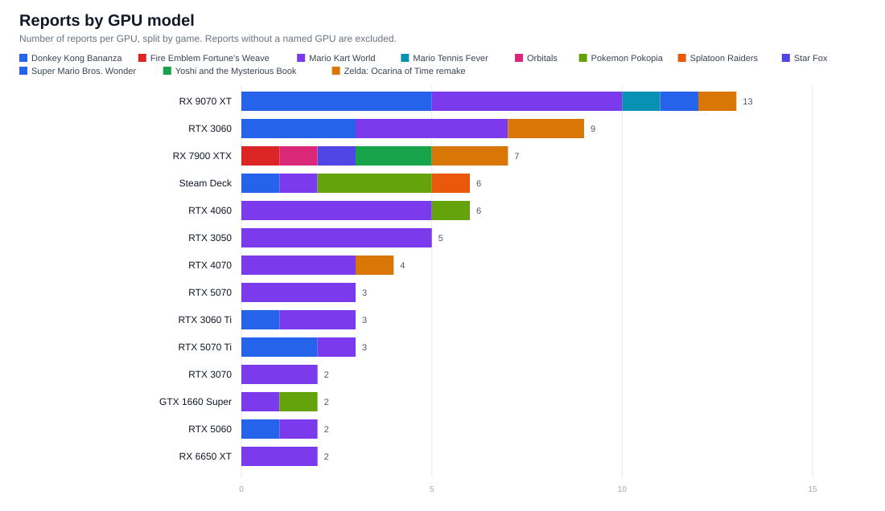
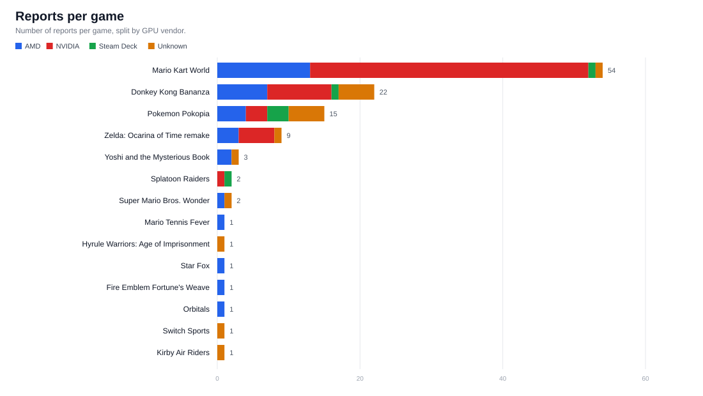
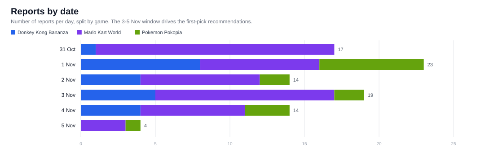
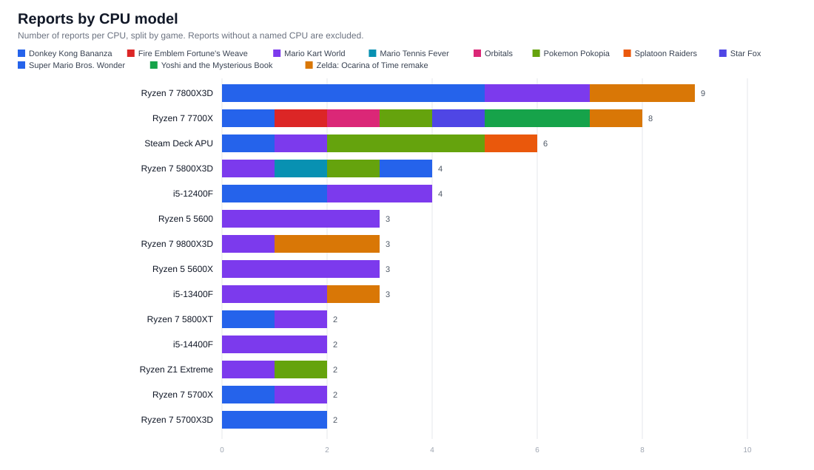
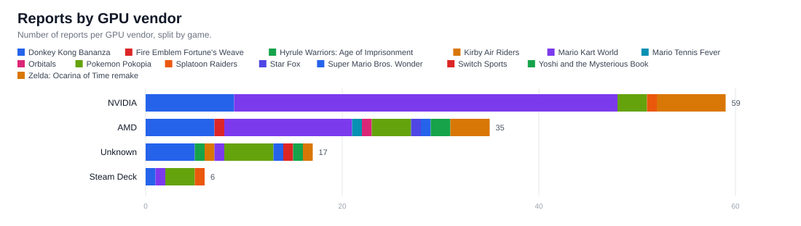
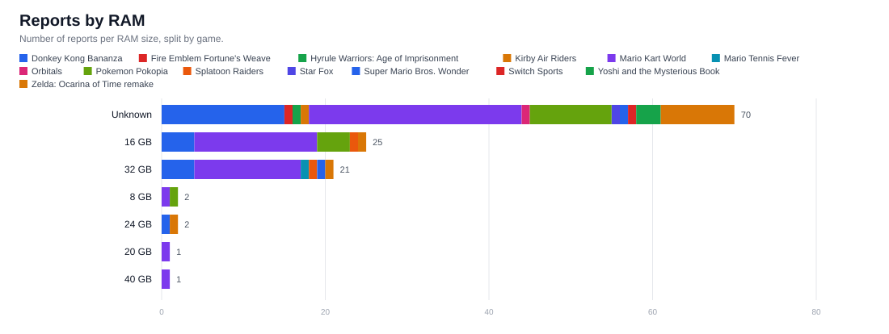
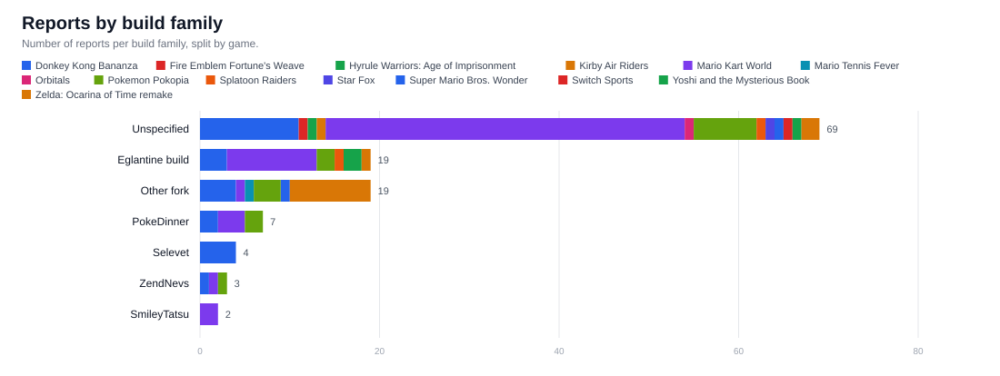
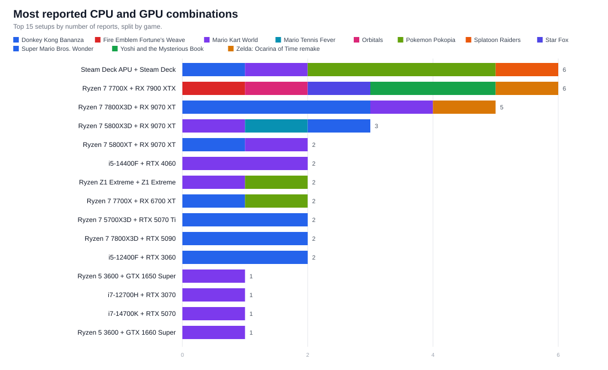

# Coverage: what was tested on what

<!-- Generated by scripts/performance_data.py. Do not edit by hand. -->

The dataset has 114 reports across 14 games, 95 with a named GPU, 87 with a named CPU and 64 distinct CPU and GPU combinations. 37 reports are from the 3-5 Nov window used for the first-pick recommendations.

The source data is [`data/performance-reports.json`](../data/performance-reports.json). Charts are in [`charts/`](charts/).

## Charts

## Recent reports (3-5 Nov)

These are the reports used for the first-pick recommendations. Older rows are history, not current evidence.

| Date | Game | Build | Setup | Performance | Source |
|---|---|---|---|---|---|
| 5 Nov | Mario Kart World | Orchid v0.7.2 | Ryzen 7 5800X3D / RX 9070 XT | 30-40 FPS | Orchid README |
| 5 Nov | Mario Kart World | unspecified | Ryzen 7 7840HS / RTX 4060 | 20 FPS | Discord, 5 Nov |
| 5 Nov | Mario Kart World | unspecified | Ryzen 5 5600X / RTX 5070 | 30 FPS | Discord, 5 Nov |
| 4 Nov | Pokemon Pokopia | Eglantine build 212 PGO | Steam Deck APU / Steam Deck | 40-50 FPS, dips to 30 | SigHya Discord, 4 Nov |
| 4 Nov | Pokemon Pokopia | notsapinho | i5 12th-gen / RTX 4060 | 80+ FPS | Discord, 4 Nov |
| 4 Nov | Mario Kart World | Eglantine build 212 PGO | Steam Deck APU / Steam Deck | unplayable, very bad stutter | SigHya Discord, 4 Nov |
| 4 Nov | Mario Kart World | unspecified | Core Ultra 7 265KF / RTX 5070 Ti | most of the game at 60, drops near CPUs | Discord, 4 Nov |
| 4 Nov | Mario Kart World | unspecified | i5-14400F / RTX 4060 | 43-50 max, 60 only in menus | Discord, 4 Nov |
| 4 Nov | Mario Kart World | build 196 | Core Ultra 255HX / Unknown | 55-60 FPS | Discord, 4 Nov |
| 4 Nov | Mario Kart World | unspecified | Ryzen 7 7800X3D / RX 9070 XT | close to 60, 40 while compiling | Discord, 4 Nov |
| 4 Nov | Mario Kart World | unspecified | i7-14700KF / RTX 5080 | about 60 time trial, 30 in water races | Discord, 4 Nov |
| 4 Nov | Donkey Kong Bananza | Eglantine build 212 PGO | Steam Deck APU / Steam Deck | 10-15 FPS | SigHya Discord, 4 Nov |
| 4 Nov | Donkey Kong Bananza | PokeDinner 2.5 | Ryzen 5 9600X / RX 6800 | 30 FPS option, no glitches, smooth | Discord, 4 Nov |
| 4 Nov | Donkey Kong Bananza | unspecified | i5-12700KF / RTX 3060 Ti | 30 FPS, 15 during destruction | Discord, 4 Nov |
| 4 Nov | Donkey Kong Bananza | PokeDinner latest | i5-12400F / RTX 3060 | 10 FPS on the Hilltop layer | Discord, 4 Nov |
| 3 Nov | Pokemon Pokopia | ZendNevs v2.0.4 | Ryzen 5 2600 / GTX 1660 Super | 60 FPS, drops to 50 | SigHya Discord, 3 Nov |
| 3 Nov | Mario Kart World | unspecified | i7-14700K / RTX 5070 | 60 FPS 98% of the time | SigHya Discord, 3 Nov |
| 3 Nov | Mario Kart World | unspecified | Ryzen 5 3600 / GTX 1660 Super | 34-45 FPS | SigHya Discord, 3 Nov |
| 3 Nov | Mario Kart World | unspecified | Ryzen 7 2700 / RTX 4060 | close to 30 FPS, unstable frametimes | SigHya Discord, 3 Nov |
| 3 Nov | Mario Kart World | ZendNevs v2.0.5 | Ryzen 5 5500X3D / RTX 4070 | 56 FPS average, 44-50 in the lowest 10% | ZendNevs release notes |
| 3 Nov | Mario Kart World | build 135 | Ryzen 7 5800XT / RX 9070 XT | time trials playable, 30 FPS lock with multiple racers | Discord, 3 Nov |
| 3 Nov | Mario Kart World | unspecified | i7-14700F / RTX 4070 Super | 60 FPS, drops to 50 | Discord, 3 Nov |
| 3 Nov | Mario Kart World | PokeDinner latest | Ryzen Z1 Extreme / Z1 Extreme | 20-30 FPS | SigHya Discord, 3 Nov |
| 3 Nov | Mario Kart World | unspecified | Ryzen 7 3800X / RX 9070 XT | 25-50 FPS | SigHya Discord, 3 Nov |
| 3 Nov | Mario Kart World | build 167 then 168 | i5-12400F / RX 6650 XT | 30-40 then 20-30 | Discord, 3 Nov |
| 3 Nov | Mario Kart World | SmileyTatsu build 11 | Ryzen 5 7600 / RX 7800 XT | 45-50 average | Discord, 3 Nov |
| 3 Nov | Mario Kart World | unspecified | Ryzen 7 5700X / RTX 5060 Ti | 60 before, 30-40 on newer build | Discord, 3 Nov |
| 3 Nov | Mario Kart World | build 130 then recent | Unknown / RTX 4070 Super | 60 then 40 | Discord, 3 Nov |
| 3 Nov | Donkey Kong Bananza | ZendNevs v2.0.3 | Ryzen 7 5800XT / RX 9070 XT | playable | ZendNevs release notes |
| 3 Nov | Donkey Kong Bananza | Selevet | i5-12400F / RTX 3060 | over 10 FPS on the Hilltop layer | Discord, 3 Nov |
| 3 Nov | Donkey Kong Bananza | zortos | Unknown / RX 6900 XT | 20-25 FPS, full textures | Discord, 3 Nov |
| 3 Nov | Donkey Kong Bananza | unspecified | Ryzen 7 5700X / RTX 5060 | 14 FPS after the first area | Discord, 3 Nov |

Reports with no named CPU or GPU are excluded from this table but remain in the JSON.

## Game by GPU vendor

| Game | NVIDIA | AMD | Intel | Steam Deck | Android | Apple | Unknown |
|---|---|---|---|---|---|---|---|
| Mario Kart World | 39 | 13 | 0 | 1 | 0 | 0 | 1 |
| Donkey Kong Bananza | 9 | 7 | 0 | 1 | 0 | 0 | 5 |
| Pokemon Pokopia | 3 | 4 | 0 | 3 | 0 | 0 | 5 |
| Zelda: Ocarina of Time remake | 5 | 3 | 0 | 0 | 0 | 0 | 1 |
| Yoshi and the Mysterious Book | 0 | 2 | 0 | 0 | 0 | 0 | 1 |
| Splatoon Raiders | 1 | 0 | 0 | 1 | 0 | 0 | 0 |
| Super Mario Bros. Wonder | 0 | 1 | 0 | 0 | 0 | 0 | 1 |
| Mario Tennis Fever | 0 | 1 | 0 | 0 | 0 | 0 | 0 |
| Hyrule Warriors: Age of Imprisonment | 0 | 0 | 0 | 0 | 0 | 0 | 1 |
| Star Fox | 0 | 1 | 0 | 0 | 0 | 0 | 0 |
| Fire Emblem Fortune's Weave | 0 | 1 | 0 | 0 | 0 | 0 | 0 |
| Orbitals | 0 | 1 | 0 | 0 | 0 | 0 | 0 |
| Switch Sports | 0 | 0 | 0 | 0 | 0 | 0 | 1 |
| Kirby Air Riders | 0 | 0 | 0 | 0 | 0 | 0 | 1 |

## Game by top GPU models

| Game | RX 9070 XT | RTX 3060 | RX 7900 XTX | Steam Deck | RTX 4060 | RTX 3050 | RTX 5070 | RTX 4070 | RTX 3060 Ti | RTX 5070 Ti | GTX 1660 Super | RTX 5060 |
|---|---|---|---|---|---|---|---|---|---|---|---|---|
| Mario Kart World | 5 | 4 | 0 | 1 | 5 | 5 | 3 | 3 | 2 | 1 | 1 | 1 |
| Donkey Kong Bananza | 4 | 2 | 0 | 1 | 0 | 0 | 0 | 0 | 1 | 2 | 0 | 1 |
| Pokemon Pokopia | 0 | 0 | 0 | 3 | 1 | 0 | 0 | 0 | 0 | 0 | 1 | 0 |
| Zelda: Ocarina of Time remake | 0 | 1 | 2 | 0 | 0 | 0 | 0 | 0 | 0 | 0 | 0 | 0 |
| Yoshi and the Mysterious Book | 0 | 0 | 2 | 0 | 0 | 0 | 0 | 0 | 0 | 0 | 0 | 0 |
| Splatoon Raiders | 0 | 0 | 0 | 1 | 0 | 0 | 0 | 0 | 0 | 0 | 0 | 0 |
| Super Mario Bros. Wonder | 1 | 0 | 0 | 0 | 0 | 0 | 0 | 0 | 0 | 0 | 0 | 0 |
| Mario Tennis Fever | 1 | 0 | 0 | 0 | 0 | 0 | 0 | 0 | 0 | 0 | 0 | 0 |
| Hyrule Warriors: Age of Imprisonment | 0 | 0 | 0 | 0 | 0 | 0 | 0 | 0 | 0 | 0 | 0 | 0 |
| Star Fox | 0 | 0 | 1 | 0 | 0 | 0 | 0 | 0 | 0 | 0 | 0 | 0 |
| Fire Emblem Fortune's Weave | 0 | 0 | 1 | 0 | 0 | 0 | 0 | 0 | 0 | 0 | 0 | 0 |
| Orbitals | 0 | 0 | 1 | 0 | 0 | 0 | 0 | 0 | 0 | 0 | 0 | 0 |
| Switch Sports | 0 | 0 | 0 | 0 | 0 | 0 | 0 | 0 | 0 | 0 | 0 | 0 |
| Kirby Air Riders | 0 | 0 | 0 | 0 | 0 | 0 | 0 | 0 | 0 | 0 | 0 | 0 |

An all-zero row means the reports did not name that GPU; check the vendor table for Unknown counts.

## Game by CPU vendor

| Game | AMD | Intel | Apple | ARM | Unknown |
|---|---|---|---|---|---|
| Mario Kart World | 26 | 21 | 0 | 0 | 7 |
| Donkey Kong Bananza | 12 | 3 | 0 | 0 | 7 |
| Pokemon Pokopia | 7 | 1 | 0 | 0 | 7 |
| Zelda: Ocarina of Time remake | 4 | 3 | 0 | 0 | 2 |
| Yoshi and the Mysterious Book | 2 | 0 | 0 | 0 | 1 |
| Splatoon Raiders | 1 | 1 | 0 | 0 | 0 |
| Super Mario Bros. Wonder | 1 | 0 | 0 | 0 | 1 |
| Mario Tennis Fever | 1 | 0 | 0 | 0 | 0 |
| Hyrule Warriors: Age of Imprisonment | 0 | 0 | 0 | 0 | 1 |
| Star Fox | 1 | 0 | 0 | 0 | 0 |
| Fire Emblem Fortune's Weave | 1 | 0 | 0 | 0 | 0 |
| Orbitals | 1 | 0 | 0 | 0 | 0 |
| Switch Sports | 0 | 0 | 0 | 0 | 1 |
| Kirby Air Riders | 0 | 0 | 0 | 0 | 1 |

## Game by build family

| Game | PokeDinner | ZendNevs | SmileyTatsu | Selevet | Eglantine build | Other fork | Unspecified |
|---|---|---|---|---|---|---|---|
| Mario Kart World | 2 | 1 | 2 | 0 | 10 | 1 | 38 |
| Donkey Kong Bananza | 2 | 1 | 0 | 4 | 2 | 3 | 10 |
| Pokemon Pokopia | 2 | 1 | 0 | 0 | 2 | 3 | 7 |
| Zelda: Ocarina of Time remake | 0 | 0 | 0 | 0 | 1 | 8 | 0 |
| Yoshi and the Mysterious Book | 0 | 0 | 0 | 0 | 2 | 0 | 1 |
| Splatoon Raiders | 0 | 0 | 0 | 0 | 1 | 0 | 1 |
| Super Mario Bros. Wonder | 0 | 0 | 0 | 0 | 0 | 1 | 1 |
| Mario Tennis Fever | 0 | 0 | 0 | 0 | 0 | 1 | 0 |
| Hyrule Warriors: Age of Imprisonment | 0 | 0 | 0 | 0 | 0 | 0 | 1 |
| Star Fox | 0 | 0 | 0 | 0 | 0 | 0 | 1 |
| Fire Emblem Fortune's Weave | 0 | 0 | 0 | 0 | 0 | 0 | 1 |
| Orbitals | 0 | 0 | 0 | 0 | 0 | 0 | 1 |
| Switch Sports | 0 | 0 | 0 | 0 | 0 | 0 | 1 |
| Kirby Air Riders | 0 | 0 | 0 | 0 | 0 | 0 | 1 |

## Setups tested

| CPU | GPU | RAM | Games tested | Reports |
|---|---|---|---|---|
| Steam Deck APU | Steam Deck | 16 GB | Donkey Kong Bananza, Mario Kart World, Pokemon Pokopia, Splatoon Raiders | 6 |
| Ryzen 7 7700X | RX 7900 XTX | not stated | Fire Emblem Fortune's Weave, Orbitals, Star Fox, Yoshi and the Mysterious Book, Zelda: Ocarina of Time remake | 6 |
| Ryzen 7 7800X3D | RX 9070 XT | not stated | Donkey Kong Bananza, Mario Kart World | 4 |
| Ryzen 7 5800X3D | RX 9070 XT | 32 GB | Mario Kart World, Mario Tennis Fever, Super Mario Bros. Wonder | 3 |
| Ryzen 7 5800XT | RX 9070 XT | 32 GB DDR4 | Donkey Kong Bananza, Mario Kart World | 2 |
| Ryzen Z1 Extreme | Z1 Extreme | not stated | Mario Kart World, Pokemon Pokopia | 2 |
| Ryzen 7 7700X | RX 6700 XT | not stated | Donkey Kong Bananza, Pokemon Pokopia | 2 |
| Ryzen 7 5700X3D | RTX 5070 Ti | 32 GB | Donkey Kong Bananza | 2 |
| Ryzen 7 7800X3D | RTX 5090 | not stated | Donkey Kong Bananza | 2 |
| i5-12400F | RTX 3060 | 16 GB | Donkey Kong Bananza | 2 |
| i7-14700K | RTX 5070 | 32 GB | Mario Kart World | 1 |
| Ryzen 5 3600 | GTX 1660 Super | 16 GB | Mario Kart World | 1 |
| Ryzen 7 2700 | RTX 4060 | 32 GB | Mario Kart World | 1 |
| Ryzen 5 5500X3D | RTX 4070 | 16 GB | Mario Kart World | 1 |
| i7-13620H | RTX 4070 | 16 GB DDR5 | Mario Kart World | 1 |
| Ryzen 5 5600 | RTX 3060 Ti | 16 GB DDR4 | Mario Kart World | 1 |
| Core Ultra 9 185H | RTX 4070 | 32 GB | Mario Kart World | 1 |
| i5-14600KF | RTX 3060 | 16 GB | Mario Kart World | 1 |
| i5-12450H | RTX 3050 | 32 GB DDR4 | Mario Kart World | 1 |
| Ryzen 5 8400F | RTX 5060 | 32 GB | Mario Kart World | 1 |
| Ryzen 5 5600G | RX 7600 | 16 GB | Mario Kart World | 1 |
| i7-12650H | RTX 4060 | 16 GB DDR5 | Mario Kart World | 1 |
| i7-8700 | GTX 1660 Ti | 32 GB 2400 | Mario Kart World | 1 |
| Ryzen 7 9800X3D | RX 9070 XT | 32 GB DDR5 | Mario Kart World | 1 |
| Ryzen 5 5600X | RX 6650 XT | 16 GB DDR4 | Mario Kart World | 1 |
| Ryzen 7 5800X | RX 6800 XT | 32 GB | Mario Kart World | 1 |
| i9-9900KF | RTX 3070 | 20 GB | Mario Kart World | 1 |
| i5-12400F | RTX 3050 | 16 GB DDR5 | Mario Kart World | 1 |
| Ryzen 9 5900HS | RTX 3060 | 40 GB DDR4 | Mario Kart World | 1 |
| i7-9700T | RTX A2000 | 16 GB | Mario Kart World | 1 |

## Gaps

- Yoshi and the Mysterious Book: no NVIDIA report.
- Super Mario Bros. Wonder: no NVIDIA report.
- Mario Tennis Fever: no NVIDIA report.
- Hyrule Warriors: Age of Imprisonment: no NVIDIA or AMD report.
- Star Fox: no NVIDIA report.
- Fire Emblem Fortune's Weave: no NVIDIA report.
- Orbitals: no NVIDIA report.
- Switch Sports: no NVIDIA or AMD report.
- Kirby Air Riders: no NVIDIA or AMD report.

These gaps use all reports. A game can look covered by an old report and still have no recent result.

Reports marked `not stated` for CPU, GPU or RAM are counted in the game totals but excluded from setup charts.

## Missing data

Most reports do not include the driver version, game version or 1% lows. A repeated setup with a different build can still produce a different result.
